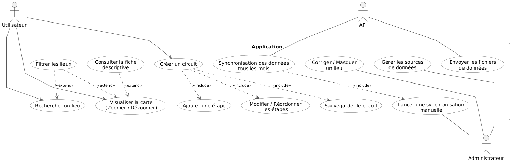
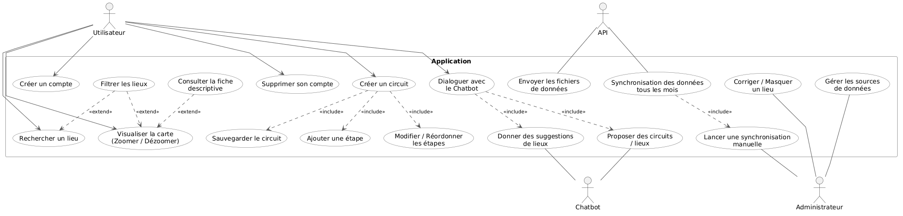
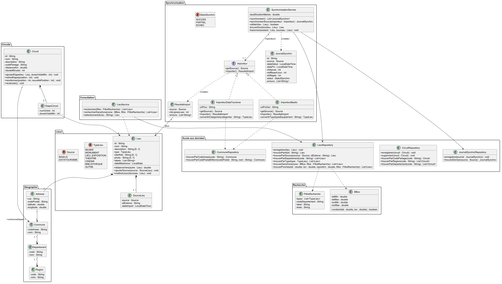
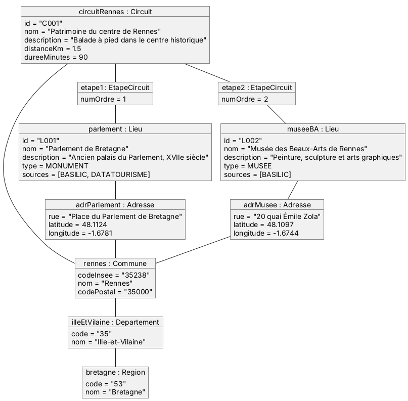
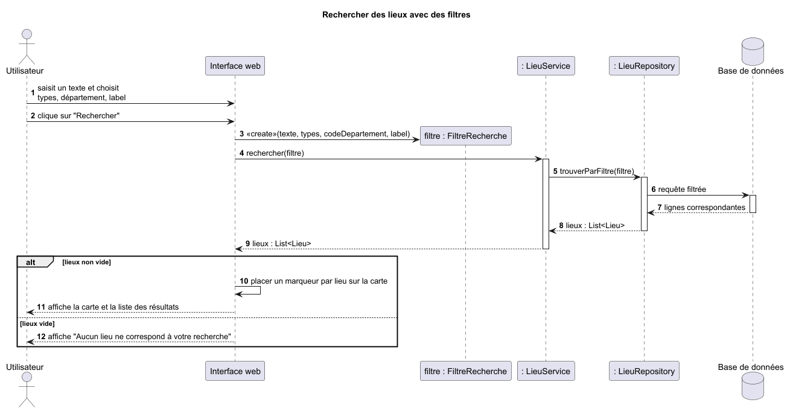
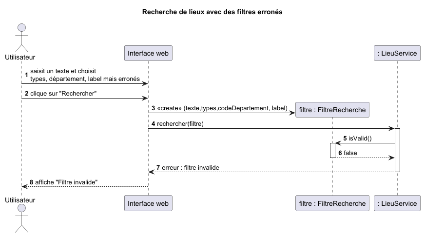
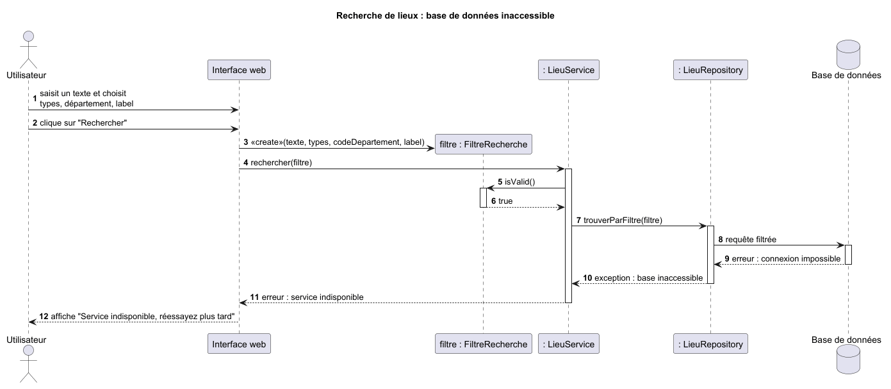

# Document d'Architecture Logicielle - Artlas

Ce document décrit l'architecture logicielle du projet **Artlas**, incluant ses modèles statiques (organisation en packages, classes principales, responsabilités et instances) ainsi que ses modèles dynamiques (cas d'utilisation, cas nominaux et scénario exceptionnels).

---

## 1. Vue d'ensemble de l'architecture

L'application repose sur une architecture multicouche modulaire :
* **Couche Présentation (Interface web)** : Interface cartographique interactive basée sur OpenStreetMap permettant la recherche, le filtrage, la consultation de fiches descriptives et la gestion d'itinéraires.
* **Couche Métier (Services)** : Orchestration de la logique applicative via `LieuService` (consultation et recherche) et `SynchronisationService` (importation, validation et dédoublonnage des données ouvertes).
* **Couche Domaine (Modèle)** : Représentation des entités métier (`Lieu`, `Circuit`, `EtapeCircuit`, `Adresse`, `Commune`, `Departement`, `Region`).
* **Couche Accès aux données (Repositories)** : Abstraction de la persistance des données (`LieuRepository`, `CircuitRepository`, `CommuneRepository`, `JournalSynchroRepository`) interagissant avec la base de données.

---

## 2. Spécification des cas d'utilisation

### 2.1 Périmètre de la V1
Dans la première version, trois acteurs interagissent avec le système :
* **Utilisateur** : peut visualiser la carte (zoomer/dézoomer), consulter la fiche descriptive d'un lieu, rechercher un lieu (avec possibilité de filtrer les résultats), et créer un circuit (ajouter une étape, modifier/réordonner les étapes, sauvegarder le circuit).
* **Administrateur** : peut gérer les sources de données, corriger ou masquer un lieu, et lancer une synchronisation manuelle.
* **API (Sources externes)** : fournit les fichiers de données et intervient lors de la synchronisation mensuelle automatisée.



### 2.2 Évolutions prévues en V2
La version V2 étend les fonctionnalités avec :
* La gestion de compte (`Créer un compte`, `Supprimer son compte`) pour l'**Utilisateur**.
* L'intégration d'un acteur secondaire **Chatbot** permettant à l'utilisateur de dialoguer avec un assistant pour obtenir des suggestions de lieux et des propositions de circuits.



---

## 3. Modèles statiques

### 3.1 Organisation des packages et responsabilités des classes

Le modèle statique est structuré en **7 packages** fonctionnels :



#### Package `Lieux`
* **`Lieu`** : Entité centrale représentant un point d'intérêt culturel (`id`, `nom`, `description`, `type`, `siteWeb`, `photo`, `labels`, `dateMiseAJour`). Elle calcule sa distance vers un autre lieu (`distanceVers`), gère ses provenances (`ajouterSource`) et permet la mise à jour de ses informations (`mettreAJour`).
* **`TypeLieu` (Enum)** : Typologie de l'établissement (`MUSEE`, `MONUMENT`, `LIEU_EXPOSITION`, `THEATRE`, `CINEMA`, `BIBLIOTHEQUE`, `AUTRE`).
* **`Source` (Enum)** : Origine de la donnée ouverte (`BASILIC`, `DATATOURISME`).
* **`SourceLieu`** : Associe un lieu à sa source d'origine avec son identifiant externe (`idExterne`) et sa date d'importation (`dateImport`).

#### Package `Géographie`
* **`Adresse`** : Coordonnées postales et géographiques d'un lieu (`rue`, `codePostal`, `latitude`, `longitude`) rattachées à une commune.
* **`Commune`**, **`Departement`**, **`Region`** : Hiérarchie administrative française (identifiée par `codeInsee` ou `code` et `nom`) permettant le rattachement territorial des lieux et des circuits.

#### Package `Circuits`
* **`Circuit`** : Représente un itinéraire culturel composé d'au moins deux étapes (`id`, `nom`, `description`, `codePartage`, `distanceKm`, `dureeMinutes`). Il expose les opérations métier d'ajout (`ajouterEtape`), de suppression (`retirerEtape`), de réorganisation (`reordonner`) et de mise à jour des métriques (`recalculer`).
* **`EtapeCircuit`** : Maillon d'un circuit associant un `Lieu` à un ordre de passage (`numOrdre`) et une durée de visite estimée (`dureeVisiteMin`).

#### Package `Consultation`
* **`LieuService`** : Service métier exposant les fonctionnalités de recherche multicritères (`rechercher`), de recherche géographique par zone (`rechercherDansZone`) et de sélection d'une fiche détaillée (`selectionner`).

#### Package `Recherche`
* **`FiltreRecherche`** : Objet regroupant les critères de filtrage saisis par l'utilisateur (`types`, `codeDepartement`, `label`, `texte`).
* **`BBox`** (*Bounding Box*) : Cadre géographique rectangulaire (`latMin`, `latMax`, `lonMin`, `lonMax`) permettant de vérifier si un point est inclus dans la zone visible de la carte (`contient`).

### Package `Synchronisation`
* **`SynchronisationService`** : Orchestre l'importation des données depuis les différentes sources (`synchroniser`, `synchroniserSource`), valide la conformité des lieux (`valider`), détecte les doublons selon un rayon paramétré (`seuilDoublonMetres`, `trouverDoublon`) et fusionne les enregistrements (`fusionner`).
* **`Importeur` (Interface)**, **`ImporteurBasilic`**, **`ImporteurDataTourisme`** : Implémentent le patron *Strategy* pour extraire et convertir les flux bruts (fichiers ou URLs) en objets métier standardisés.
* **`ResultatImport`**, **`JournalSynchro`**, **`StatutSynchro` (Enum)** : Assurent la traçabilité des opérations d'importation (nombre d'ajouts, mises à jour, rejets, liste d'erreurs et statut final `SUCCES`, `PARTIEL` ou `ECHEC`).

#### Package `Accès aux données`
* **`LieuRepository`**, **`CircuitRepository`**, **`CommuneRepository`**, **`JournalSynchroRepository`** : Composants chargés de la persistance et des requêtes de sélection par identifiant, département, région, code partage ou zone géographique.

---

### 3.2 Exemple d'instanciation (Diagramme d'objets)

Le diagramme d'objets ci-dessous illustre un état concret du système pour un circuit rennais (`circuitRennes`, `id = "C001"`) comprenant deux étapes :
1. Le **Parlement de Bretagne** (`numOrdre = 1`, type `MONUMENT`).
2. Le **Musée des Beaux-Arts de Rennes** (`numOrdre = 2`, type `MUSEE`).
   Tous deux sont localisés dans la commune de **Rennes** (`35238`), en **Ille-et-Vilaine** (`35`), région **Bretagne** (`53`).



---

## 4. Modèles dynamiques (Diagrammes de séquence)

### 4.1 Recherche et filtrage de lieux

```
Voici un exemple de diagramme de séquence avec les cas nominaux ainsi qu'un scénario exceptionnel.
```
#### Scénario nominal : Recherche avec des filtres valides
1. L'utilisateur saisit ses critères (texte, types, département, label) et lance la recherche.
2. L'interface web instancie un objet `FiltreRecherche` et appelle `LieuService.rechercher(filtre)`.
3. `LieuService` délègue la requête à `LieuRepository.trouverParFiltre(filtre)` qui interroge la base de données.
4. **Alternative (`alt`)** :
    * Si la liste retournée n'est pas vide, l'interface place un marqueur par lieu sur la carte et affiche les résultats.
    * Si la liste est vide, l'interface affiche le message *"Aucun lieu ne correspond à votre recherche"*.



#### Scénario exceptionnel 1 : Filtres erronés
Si les paramètres saisis par l'utilisateur sont mal formés, la méthode `filtre.isValid()` appelée par `LieuService` retourne `false`. Le traitement s'interrompt immédiatement sans solliciter la base de données et l'interface affiche *"Filtre invalide"*.



#### Scénario exceptionnel 2 : Base de données inaccessible
Si le filtre est valide (`isValid() == true`) mais que la connexion à la base de données échoue lors de l'appel à `LieuRepository`, une exception *"base inaccessible"* remonte jusqu'à `LieuService` qui notifie l'interface web. L'utilisateur reçoit le message *"Service indisponible, réessayez plus tard"*.



---

```
L’ensemble des diagrammes se trouve dans le répertoire docs (Diagramme de séquence/Diagramme d'état/Diagramme de classe/Diagramme d'objet/cas d'utilisation).
```


